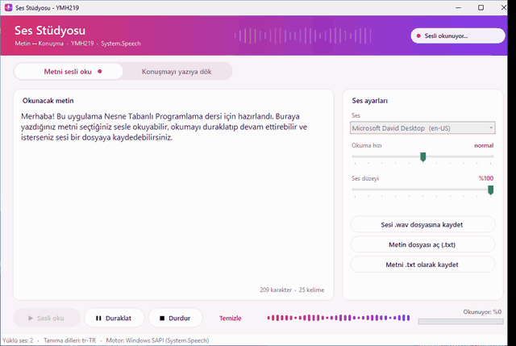
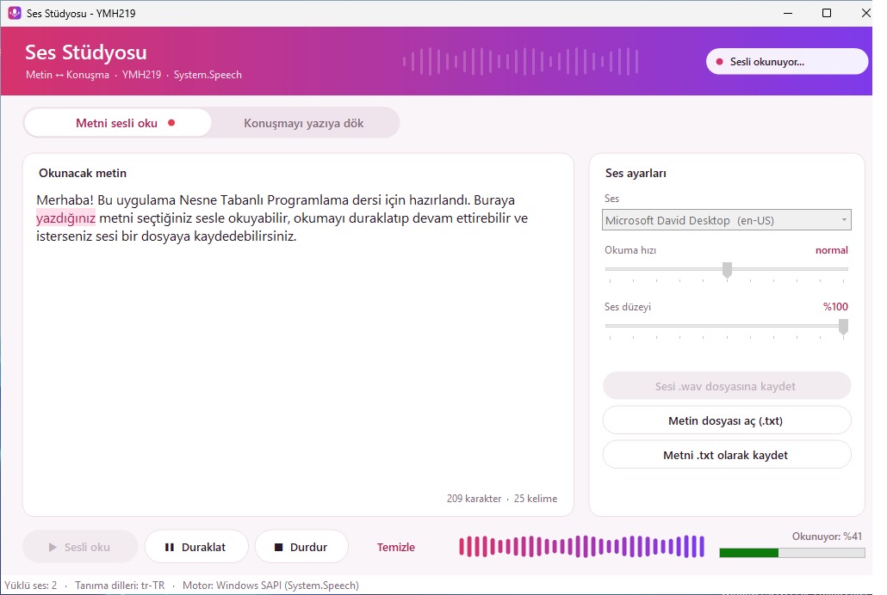
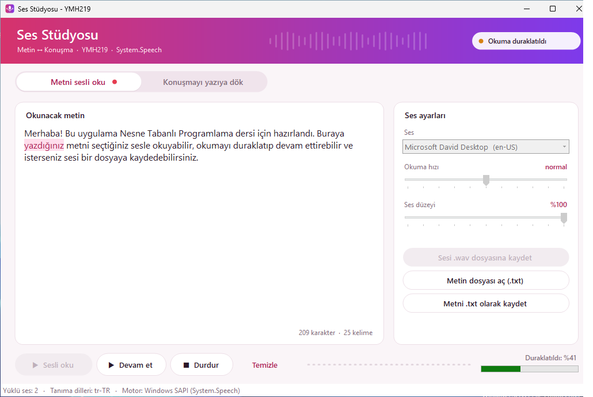
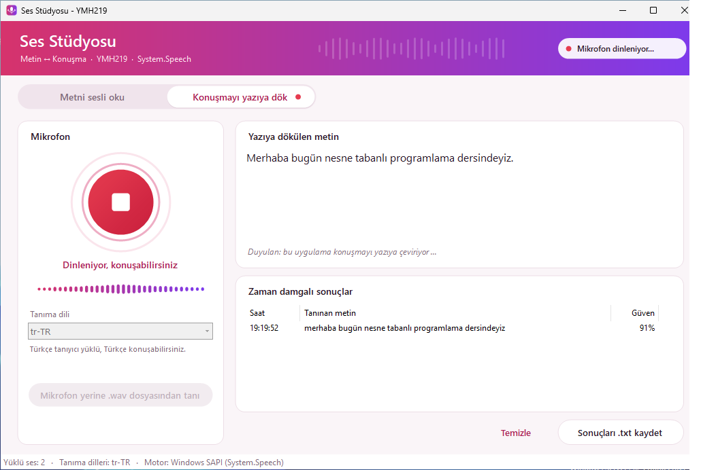
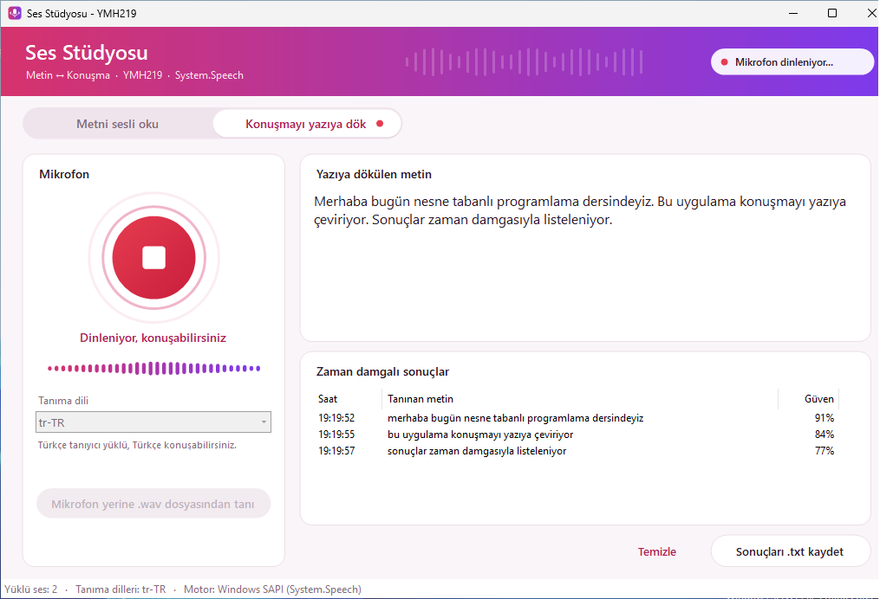
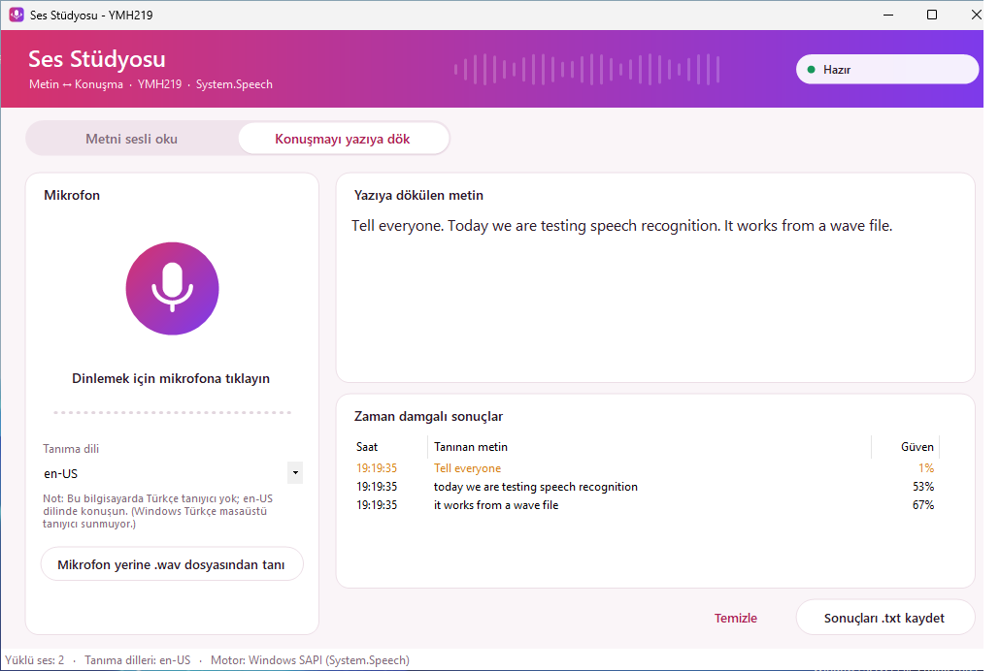
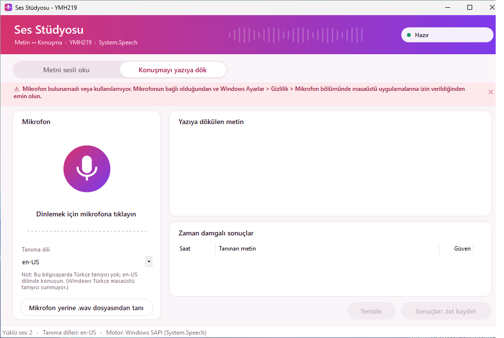
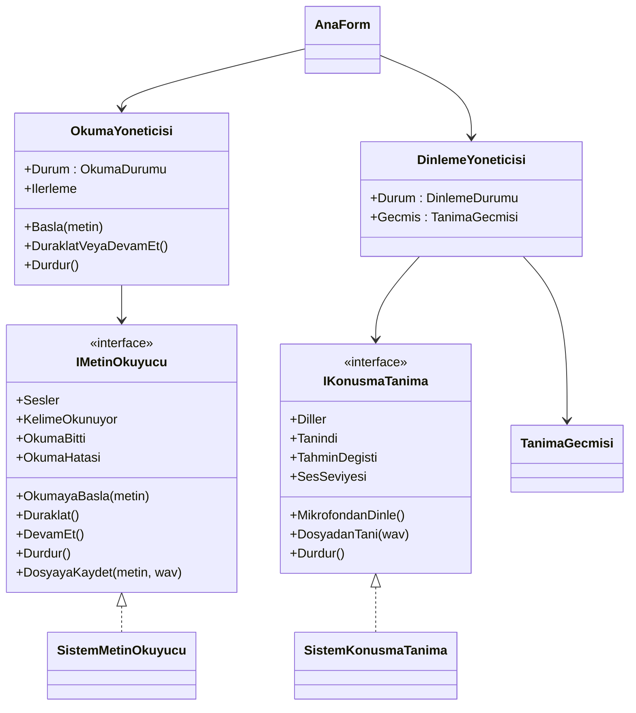
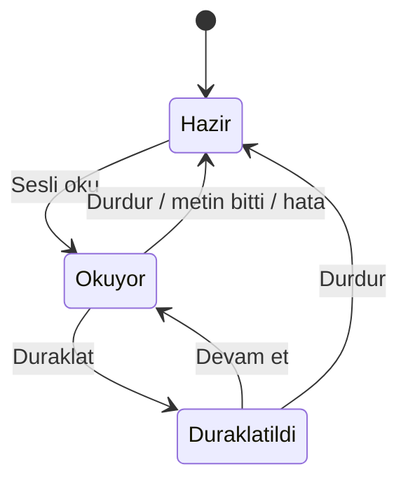

# 🎙️ Ses Stüdyosu — YMH219 SpeechApp

[](https://github.com/ozenyunus35/YMH219-SpeechApp/actions/workflows/windows.yml)

**Metni sesli okuyan** (Text-to-Speech) ve **konuşmayı yazıya döken** (Speech-to-Text) Windows Forms uygulaması.
Windows'un yerleşik konuşma motoru **System.Speech (SAPI)** kullanılıyor; internet gerekmiyor.

<p align="center"></p>

> Öğrenci: **Yunus Emre Özen** · 215542001 · YMH219 Nesne Tabanlı Programlama

---

## Ne yapabiliyor?

### 🔊 Metni sesli oku

| | |
|---|---|
| ▶ **Sesli oku** | Kutudaki metni seçilen sesle okur |
| ❚❚ **Duraklat / Devam et** | Okumayı kaldığı yerden sürdürür |
| ■ **Durdur** · **Temizle** | Okumayı bitirir / metni siler |
| Kelime vurgulama | O an okunan kelime pembe ile işaretlenir, altta ilerleme yüzdesi görünür |
| Ses, hız, ses düzeyi | Yüklü Windows sesleri arasından seçim, −10…+10 hız, %0–100 ses |
| `.wav` olarak kaydet | Okumayı ses dosyasına yazar (hoparlör olmasa da çalışır) |
| `.txt` aç / kaydet | Okunacak metni dosyadan alır veya dosyaya yazar |

### 🎤 Konuşmayı yazıya dök

| | |
|---|---|
| Mikrofon butonu | Tıkla → dinlemeye başlar, tekrar tıkla → durur |
| Canlı ses seviyesi | Mikrofondaki ses düzeyi dalga olarak görünür |
| Anlık tahmin | Konuşurken "Duyulan: …" satırında tahmin gösterilir |
| Zaman damgalı liste | Tanınan her cümle **saat** ve **güven yüzdesi** ile listelenir (düşük güvenli olanlar turuncu) |
| `.wav` dosyasından tanı | Mikrofon yoksa önceden kaydedilmiş bir konuşmayı yazıya döker |
| `.txt` kaydet | Sonuçları zaman damgalarıyla dosyaya yazar |

### Hangi işlemin aktif olduğu her yerde belli

- Sağ üstteki durum etiketi: **Hazır / Sesli okunuyor / Okuma duraklatıldı / Mikrofon dinleniyor / Ses dosyası işleniyor**
- Sekme başlığında kırmızı nokta (o sekmede işlem sürüyorsa)
- Mikrofon butonu dinlerken kırmızıya döner ve etrafında halkalar dalgalanır

### Hatalar kullanıcıya anlaşılır şekilde söyleniyor

| Durum | Uygulamanın tepkisi |
|---|---|
| Mikrofon yok / izin verilmemiş | "Mikrofon bulunamadı… Windows Ayarlar > Gizlilik > Mikrofon…" |
| Konuşma tanıyıcı yüklü değil | "Bu bilgisayarda konuşma tanıma motoru yüklü değil…" |
| Hoparlör yok | "Ses çıkış aygıtı bulunamadı… .wav olarak kaydedebilirsiniz" |
| Boş metin | "Okunacak metin yok" |
| Bozuk / .wav olmayan dosya | "Ses dosyası okunamadı…" |

Hiçbiri programı kapatmıyor; üstte kapatılabilir bir uyarı şeridi çıkıyor.

### Klavye kısayolları

| Kısayol | İşlev |
|---|---|
| `Ctrl+Enter` / `F5` | Sesli oku (okuma sekmesi) · dinlemeyi başlat/durdur (tanıma sekmesi) |
| `F6` | Duraklat / devam et |
| `Esc` | Okumayı veya dinlemeyi durdur, uyarıyı kapat |
| `Ctrl+1` / `Ctrl+2` | Sekmeler arasında geçiş |
| `Ctrl+O` / `Ctrl+S` | Metin dosyası aç / kaydet |

Bütün butonlara `Tab` ile gelinip `Enter`/`Boşluk` ile basılabiliyor (odaklanan buton çerçeveyle gösteriliyor).

## Ekran görüntüleri

| Sesli okuma (kelime vurgulu) | Duraklatıldı |
|:-:|:-:|
|  |  |

| Dinleniyor | Zaman damgalı sonuçlar |
|:-:|:-:|
|  |  |

| `.wav` dosyasından tanıma (gerçek Windows motoru) | Mikrofon yokken |
|:-:|:-:|
|  |  |

> **Not:** Ekran görüntüleri GitHub Actions'ın Windows makinesinde alındı. O makinede hoparlör ve mikrofon olmadığı için
> "okuma" ve "dinleme" görüntüleri arayüzü göstermek amacıyla **test motorlarıyla** oluşturuldu (uygulama, motorları
> arayüz üzerinden aldığı için bu mümkün). "`.wav` dosyasından tanıma" görüntüsündeki sonuç ise **gerçek** Windows
> konuşma motoruna aittir.

## Kurulum ve çalıştırma

**Gereksinimler:** Windows 10/11, .NET 10 SDK (veya Visual Studio 2026).
NuGet paketi: [`System.Speech`](https://www.nuget.org/packages/System.Speech) (derlemede otomatik iner).

```bash
git clone https://github.com/ozenyunus35/YMH219-SpeechApp.git
cd YMH219-SpeechApp
dotnet run --project SpeechApp
```

Visual Studio'da `YMH219-SpeechApp.sln` → <kbd>F5</kbd>.

### Türkçe hakkında önemli not

- **Okuma:** Windows'ta Türkçe ses (ör. *Microsoft Tolga*) yüklüyse uygulama onu otomatik seçer. Yoksa yüklü İngilizce sesler listelenir.
- **Tanıma:** System.Speech, Windows'un masaüstü konuşma tanıyıcısını kullanır. Microsoft bu tanıyıcıyı **Türkçe için sunmuyor**;
  genelde İngilizce (en-US) yüklüdür. Uygulama yüklü dilleri listeler ve Türkçe yoksa bunu ekranda belirtir.
  En iyi sonuç için tanıma dilinde (ör. İngilizce) konuşun.

## Nasıl tasarlandı?



- Form konuşma motorunu doğrudan kullanmıyor; **arayüz (interface)** üzerinden kullanıyor.
  Gerçek uygulamada `SistemMetinOkuyucu` / `SistemKonusmaTanima` (System.Speech), testlerde ise sahte motorlar veriliyor.
- Durum mantığı (`OkumaYoneticisi`, `DinlemeYoneticisi`) formdan ayrı; bu yüzden ses çıkarmadan test edilebiliyor.

Okuma durumları:



### Kaynak yönetimi

- `SpeechSynthesizer` ve `SpeechRecognitionEngine` form kapanırken `Dispose` ediliyor.
- `.wav` dosyasından tanımada dosya akışı uygulama tarafından açılıp tanıma bitince kapatılıyor
  (System.Speech'in kendi `SetInputToWaveFile`'ı hata durumunda dosyayı kilitli bırakıyordu; testler bunu yakaladı).
- Duraklatılmış bir okuma iptal edilmeden önce devam ettiriliyor (SAPI aksi halde iptali bekletiyor).
- İptal edilen eski işlemin geç gelen "bitti" bildirimi yeni işlemi etkilemiyor.

## Testler

```bash
dotnet test
```

**25 test:**

- **Durum testleri (sahte motorlarla):** boş metin, duraklat/devam/durdur, okurken yeni metin, ilerleme yüzdesi,
  okuma hatası, mikrofon yokken hata, `.wav` olmayan dosya, zaman damgalı kayıt, cümle birleştirme
- **Gerçek Windows motoru:** yüklü seslerin listelenmesi, hız/ses sınırları, metni `.wav`'a kaydedip **aynı dosyayı tekrar
  yazıya dökme** (GitHub Actions'ta: *"Hello world this is a test"* → *"Hello world this is a test"*), bozuk `.wav`

GitHub Actions her push'ta bunları Windows üzerinde çalıştırıyor.

## Bilinen sınırlamalar

- Windows'ta Türkçe masaüstü konuşma tanıyıcı yok (yukarıdaki nota bakın).
- Tanıma doğruluğu mikrofon kalitesine ve ortam gürültüsüne bağlı.
- Windows'un yeni "OneCore" sesleri System.Speech tarafından her zaman listelenmeyebilir.
- Uygulama Windows Forms ve SAPI kullandığı için yalnızca Windows'ta çalışır.
